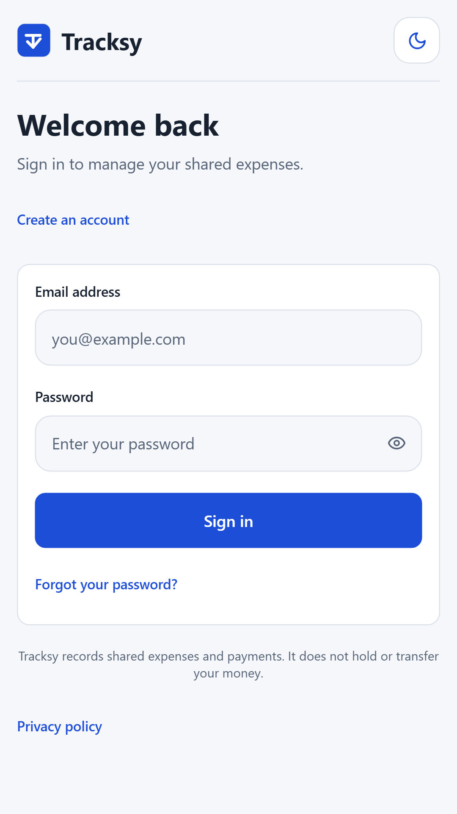
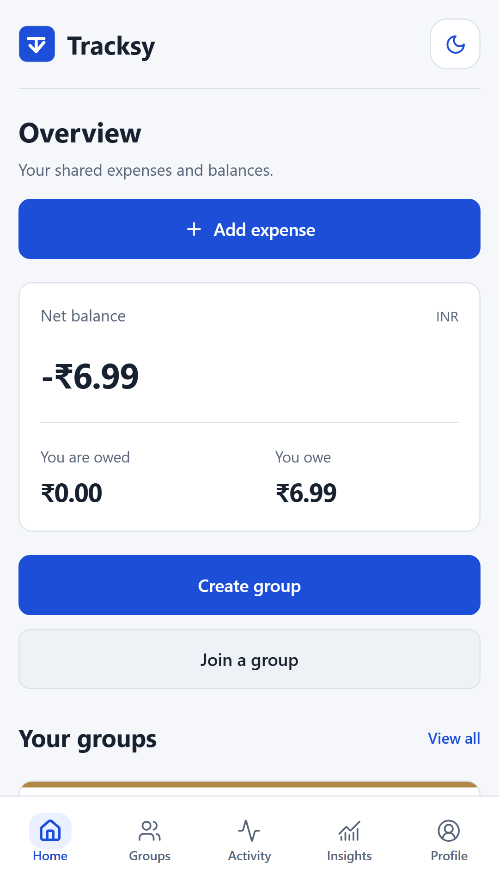
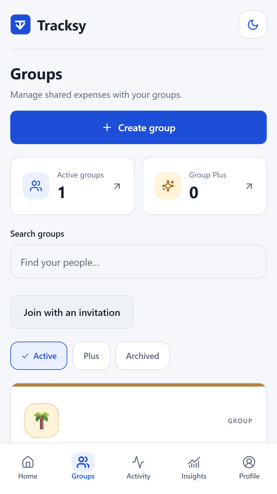
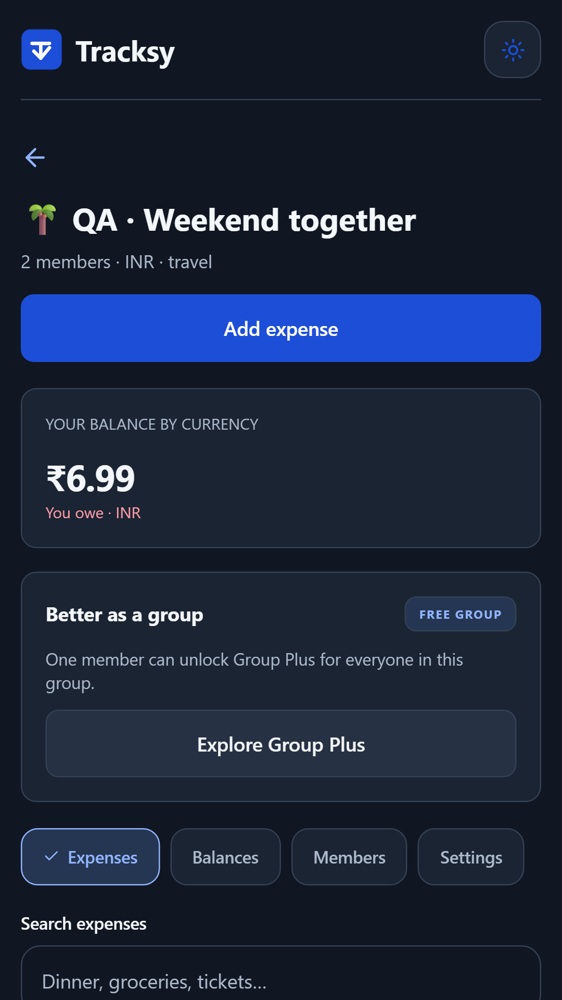

# Tracksy

**Split smarter. Settle together.**

Tracksy helps friends, families, and housemates track shared expenses, see balances, and settle up. Create groups, invite members, split expenses, and review changes in the activity history. The mobile app supports Android, iOS development builds, and a mobile-friendly web experience.

## Screenshots

These screenshots are from an earlier testing build; the current interface may differ.

| Sign in | Overview | Groups | Group details |
| --- | --- | --- | --- |
|  |  |  |  |

An Expo / React Native expense-sharing app, a Supabase PostgreSQL backend, and a Next.js operations console. Real expense operations run through transactional database functions and RLS. No mock financial records, login bypass, or client-side premium activation is included.

This is an implementation in progress, **not a launch-ready release**. See [STATUS.md](docs/STATUS.md) for implemented behavior, evidence, remaining features, and external setup requirements.

## Run

Requirements: Node 22.12+ or 24 LTS, npm, and either a configured Supabase project or Supabase CLI plus Docker Desktop. Native development also requires Expo development builds and the relevant platform tooling.

```powershell
npm ci
Copy-Item apps/mobile/.env.example apps/mobile/.env
Copy-Item apps/admin/.env.example apps/admin/.env.local
```

For a local backend, install Supabase CLI through its [supported installation method](https://supabase.com/docs/guides/local-development/cli/getting-started), then:

```powershell
npm run db:start
npm run db:reset
supabase status
```

Put the returned **public URL and anon/publishable key** in the client env files. Android emulator uses `http://10.0.2.2:54321`; a physical device needs a reachable development host address. Never put a service-role, RevenueCat secret, or AI secret in an Expo env file.

For hosted Supabase, link the project and apply migrations with `supabase db push`. See [deployment instructions](docs/deployment/README.md) before doing so.

For a brand-new empty Supabase project, `npm run db:prepare` also produces `supabase/bootstrap.sql` for the SQL editor. It does not contact the backend; review the migration-history instructions before using it.

```powershell
npm run dev        # Expo, native development build
npm run web        # same application in a browser
npm run admin      # Next.js console on port 3001
```

Without Supabase configuration, the app renders an explicit setup state. Financial actions remain unavailable. This is not an offline replacement for the backend.

## First shared expense

1. Register two accounts and verify both emails. For local Supabase, open the email link from its local mail interface. Use the same browser/device that initiated the PKCE flow.
2. First account: create a group, open Members, create an email-bound invitation, and share its link or code.
3. Second account: sign in, open Groups → Join with an invitation, and accept the code.
4. Add an expense, select participants and payers, and save. Each member sees the same server-derived shares and balances.
5. Record a partial or full payment. The counterparty confirms it. Pending records never change balances and user confirmations are explicitly unverified by a payment provider.
6. Correct or reverse an expense. Original events remain available in the activity and ledger history.

Web sessions intentionally live in memory; page reloads require a fresh sign-in. Native refresh tokens use Keychain/Keystore. Offline drafts use SQLite on native and IndexedDB on web and never count as shared financial records until synchronized.

## Verify

```powershell
npm run typecheck
npm test
npm run export -w @tracksy/mobile
npm run build -w @tracksy/admin
npm exec -- playwright install chromium
npm exec -- playwright test
```

The PostgreSQL integration tests execute migrations and authorization rules using PGlite. They emulate Supabase's auth claims and storage metadata so they can run without Docker. They do **not** verify the live Auth service, Storage HTTP service, Realtime transport, or storefronts. Browser smoke tests cover the unauthenticated setup and protected routes; live multi-user E2E remains a separate acceptance requirement.

## Structure

```text
apps/mobile       Expo Router, Android / iOS / web
apps/admin        Next.js, server-side auth and TOTP MFA
apps/web          standalone Next.js client deferred; see its README
packages/domain   shared domain interfaces
packages/finance  integer arithmetic and deterministic allocations
packages/validation Zod schemas
packages/ui       theme, typography, spacing and radius tokens
packages/config   categories, translation foundations, staged flags
supabase/migrations  authoritative schema, RLS and transactional RPCs
supabase/functions   verified billing and scheduled workers
tests             finance, PostgreSQL and browser tests
docs              architecture, billing, security, operations and status
```

The client SDK entitlement display is informational. The database's `has_group_feature` function checks identity, membership, feature, group entitlement status and expiration. Billing mappings are immutable and verified server-side.
